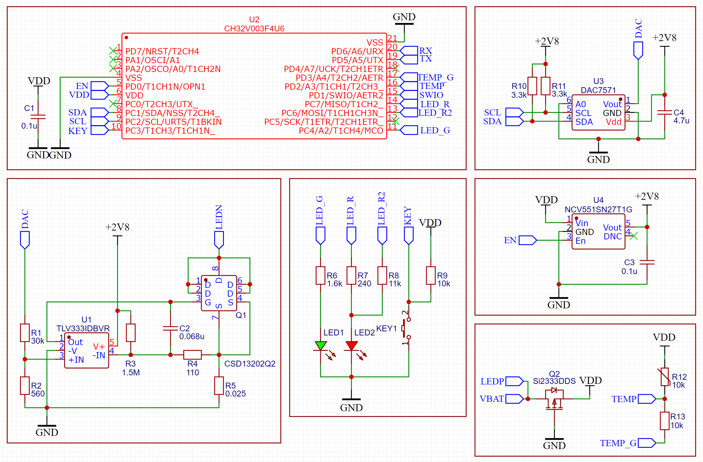

# Proteus 32 — Flashlight Driver Firmware

[](https://www.wch-ic.com/products/CH32V003.html)
[]()
[]()
[](license.md)
[](license.md)
[](license.md)

**Proteus 32** — это продвинутая прошивка для драйвера светодиодного фонаря с управлением одной тактовой кнопкой.

Аппаратная часть унаследовала проверенную силовую схемотехнику от драйвера **Proteus IID**, однако управляющее ядро полностью перенесено на современный 32-битный RISC-V микроконтроллер **WCH CH32V003**. Это позволило достичь идеальной плавности регулировки яркости, внедрить ПИ-регулятор термоконтроля, гибкую систему кастомизации кликов и собственный UART-загрузчик.

## Схема драйвера



---

## 🚀 Основные возможности

* **3 переключаемых интерфейса управления (UI):**
  * **UI1 (Рампинг):** плавное бесступенчатое изменение яркости во всём диапазоне без видимых шагов и рывков (по умолчанию).
  * **UI2 (Дискретный с длинным кликом):** 5 фиксированных ступеней (`Min` → `Med-Low` → `Med` → `Max` → `Turbo`) + быстрый сброс на ступень вниз по длинному клику (0,25–0,6 с).
  * **UI3 (Простой дискретный):** 5 ступеней, увеличенные тайминги нажатий (~0,58 с) для защиты от случайных касаний, отсутствие длинного клика.
* **Матрица быстрого доступа (10 слотов × 12 функций):** возможность переназначить любую из 10 комбинаций кликов на нужную функцию прямо с кнопки фонаря или освободить неиспользуемые комбинации.
* **Два независимых режима памяти:**
  * *Энергонезависимая память яркости старта* (сохраняется при смене АКБ и перепрошивке).
  * *Оперативная память последнего режима* (работает, пока установлен АКБ).
* **Термоконтроль на базе ПИ-регулятора:** плавное удержание температуры без резких ступенчатых провалов яркости. Пользовательская настройка уставки от **46 °C до 60 °C** с шагом **1 °C** (по умолчанию 50 °C) и защита при отказе термодатчика.
* **Продвинутая блокировка:**
  * Блокировка как в выключенном состоянии, так и с зафиксированным включённым светом.
  * Отдельный режим «Блокировка с принудительным маяком».
  * **Временный слабый свет в блокировке:** включение слабого света по клику на 15 / 30 / 45 / 60 секунд без снятия блокировки.
* **Развитая индикация и AUX:**
  * Поддержка двухцветных (Red/Green) и трёхцветных (Red/Green/Blue) индикаторных светодиодов (ИД).
  * Настраиваемый маяк (период 1, 2, 4 или 8 с; выбор цвета ИД или вспышек основным СИД) и фоновая подсветка.
  * 6-уровневая индикация заряда АКБ (от 3,0 В до 4,0+ В) с опцией **дублирования основным светодиодом** (удобно для налобных фонарей).
  * Предупреждение о разряде АКБ во время работы (прогрессивная частота вспышек ИД).
* **Два раздельных меню конфигурации:**
  * **Меню пользователя** (при питании от АКБ < 4,5 В).
  * **Инженерное меню** (при питании от лабораторного БП или USB 4,5–5,0 В) для тонкой настройки уровня Мунлайта (15 градаций), калибровки ЦП по эталону (25 °C, 4,2 В) и полного сброса.
* **Встроенный UART-загрузчик (Bootloader):** безопасное обновление прошивки по одному проводу без потери пользовательских настроек, привязок слотов и заводских калибровок.

---

## 🎮 Краткая шпаргалка по управлению (по умолчанию)

### Базовые действия (во всех UI)
| Состояние | Жест | Действие |
| :--- | :--- | :--- |
| **Выкл** | 1 клик | Включение на сохранённой яркости старта |
| **Вкл** | 1 клик | Выключение |
| **Выкл** | Удержание | **Мунлайт** (минимальный свет) / начало рампинга в UI1 |
| **Выкл / Вкл** | 2 клика | **Турбо** (повторные 2 клика во Вкл — возврат к прежней яркости) |
| **Вкл** | Удержание | Повышение яркости (рампинг вверх в UI1 / ступень вверх в UI2, UI3) |
| **Вкл** | 1 клик + удержание | Понижение яркости (рампинг вниз в UI1 / ступень вниз в UI2, UI3) |
| **Вкл** | Длинный клик (0,25–0,6 с) | На одну ступень вниз *(только для UI2)* |
| **Вкл** | 5 кликов + удержание | Записать текущую яркость как постоянную яркость включения |

### Комбинации быстрого доступа (из состояния «Выкл»)
Каждый из 10 слотов можно переназначить в меню пользователя (Пункт 5):

| Слот | Комбинация | Действие по умолчанию |
| :---: | :--- | :--- |
| **1** | 1 клик + удержание | Индикация заряда АКБ (1–6 вспышек: от 3,0 В до 4,0+ В) |
| **2** | 2 клика + удержание | Маяк вкл / выкл |
| **3** | 3 клика | Стробы (7 профилей; удержание — следующий профиль, клик — выкл) |
| **4** | 3 клика + удержание | Тактический режим (свет горит, пока удерживается кнопка) |
| **5** | 4 клика | Блокировка вкл / выкл *(работает также из состояния «Вкл»)* |
| **6** | 4 клика + удержание | *Пусто (свободный слот)* |
| **7** | 5 кликов | *Пусто (свободный слот)* |
| **8** | 5 кликов + удержание | Оперативная память последней яркости вкл / выкл |
| **9** | 6 кликов | Слабая фоновая подсветка (AUX) вкл / выкл |
| **10** | 6 кликов + удержание | Дублирование индикации заряда основным СИД вкл / выкл |

---

## ⚙️ Системы меню

Вход в меню осуществляется при подаче питания:
1. Подайте питание на драйвер.
2. Через ~0,5 с индикаторный диод мигнёт **зелёным** (питание от АКБ — доступно *Меню пользователя*) или **красным** (питание 4,5–5,0 В — доступно *Инженерное меню*).
3. **В момент вспышки нажмите и удерживайте кнопку** около 1 секунды до подтверждающей серии вспышек (3 зелёные для пользовательского, 6 красных для инженерного).

### Пункты меню пользователя
Выбор пункта и значения внутри него производится соответствующим числом кликов. Выход из меню — **удержание** (настройки сохраняются во флеш-память автоматически через несколько секунд после выхода).

* **1 клик:** Частота вспышек маяка (`1` — 1 с, `2` — 2 с, `3` — 4 с, `4` — 8 с).
* **2 клика:** Цвет маяка (`1` — красный, `2` — зелёный, `3` — основной СИД, `4` — синий для RGB).
* **3 клика:** Цвет слабой подсветки (`1` — красный, `2` — зелёный, `3` — синий для RGB).
* **4 клика:** Выбор UI (`1` — UI1 Рампинг, `2` — UI2 Дискретный, `3` — UI3 Простой).
* **5 кликов:** Вход в режим переназначения 10 слотов быстрого доступа (12 доступных функций).
* **6 кликов:** Слабый свет в блокировке (`1` — выкл, `2` — вкл).
* **7 кликов:** Таймер слабого света в блокировке (`1` — 15 с, `2` — 30 с, `3` — 45 с, `4` — 60 с).
* **8 кликов:** Уставка термоконтроля (от `1` клика = 46 °C до `15` кликов = 60 °C, по умолчанию `5` = 50 °C).
* **9 кликов:** Индикация разряда АКБ при работающем фонаре (`1` — выкл, `2` — вкл).

### Пункты инженерного меню (питание 4,5–5,0 В)
> ⚠️ **Внимание:** При питании от лабораторного блока питания не подавайте напряжение выше 5,0 В и не включайте фонарь выше минимального режима!

* **1 клик:** Настройка минимальной яркости / Мунлайта (от `1` до `15` кликов, по умолчанию `4–6`).
* **5 кликов:** Калибровка датчиков напряжения и температуры (выполняется строго при температуре платы **25 °C** и напряжении **4,20 В** после 5–10 секунд покоя).
* **15 кликов:** Полный сброс всех пользовательских настроек, слотов и калибровок к заводским значениям.

---

## 🔄 Обновление прошивки (Bootloader)

Драйвер поддерживает обновление прошивки через стандартный преобразователь **USB-UART** с помощью оболочки **[BootUI](https://github.com/tama18101971/BootUI)**.

Связанные репозитории:
* **[Proteus32-BootLoader](https://github.com/tama18101971/Proteus32-BootLoader)** — сам загрузчик, прошиваемый в контроллер.
* **[BootUI](https://github.com/tama18101971/BootUI)** — графическая оболочка для работы с загрузчиком.

1. Зажмите кнопку фонаря **до** подачи питания.
2. Подайте питание, удерживая кнопку — драйвер перейдёт в режим загрузчика (красный ИД начнёт мигать с частотой ~2 Гц; во время передачи данных загорится зелёный ИД).
3. Запустите **BootUI** и загрузите актуальный файл прошивки.

**Особенности загрузчика:**
* Область пользовательских настроек и заводских калибровок изолирована и **не стирается** при обновлении.
* Загрузчик защищён от перезаписи: при обрыве связи достаточно просто повторить процедуру прошивки.

### Оболочка BootUI


---

## 🔧 Сборка

Прошивка собирается через [PlatformIO](https://platformio.org/):

```bash
pio run                      # сборка варианта Proteus32 (2-цветный ИД)
pio run -e Proteus32-RGB     # сборка варианта Proteus32-RGB (3-цветный ИД)
pio run -t upload            # прошивка через WCH-Link
pio device monitor           # мониторинг UART (460800 8N1)
```

Лимит флеш-памяти — **16128 B**; сборка контролируется гейтом `tools/fw_size.py` и падает при переполнении.

---

## 📄 Документация

Полное описание всех режимов, таблиц индикации и пошаговые примеры настройки приведены в [Руководстве пользователя (docs/РУКОВОДСТВО_ПОЛЬЗОВАТЕЛЯ.md)](docs/РУКОВОДСТВО_ПОЛЬЗОВАТЕЛЯ.md) / [PDF-версии](docs/Руководство_пользователя_Proteus32.pdf) в репозитории.

---

## 📜 Лицензия

Проект распространяется на условиях смешанного лицензирования:

* **Прошивка и исходный код** — [GPL-3.0-or-later](LICENSES/GPL-3.0.txt)
* **Аппаратная часть и схемы** — [CERN-OHL-S-2.0](LICENSES/CERN-OHL-S-2.0.txt)
* **Документация и медиа** — [CC-BY-SA-4.0](LICENSES/CC-BY-SA-4.0.txt)

Подробности — в файле [license.md](license.md).
